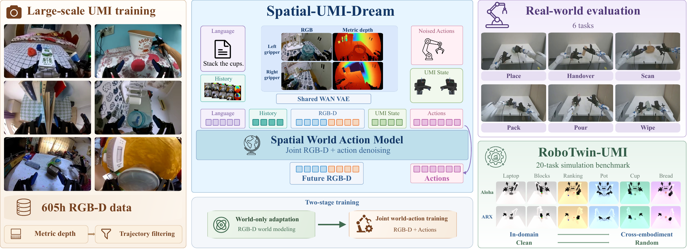
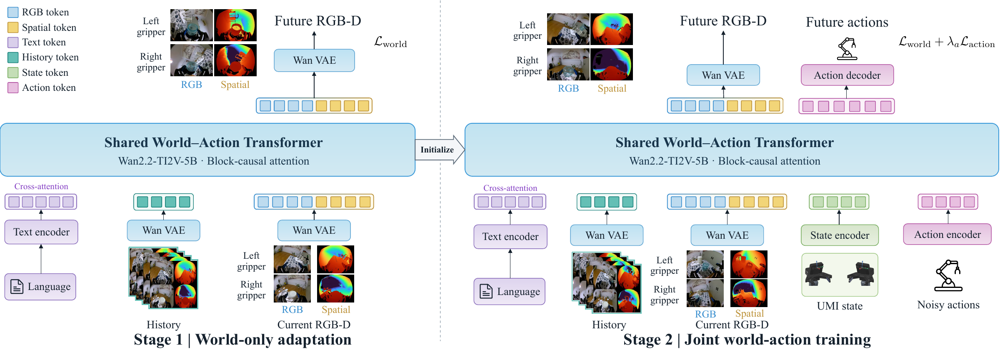

<h1 align="center">Spatial-UMI-Dream</h1>
<h3 align="center">Scaling World Action Models with Metric Geometry for UMI Manipulation</h3>

<p align="center">
  
</p>

<div align="center">

[](https://arxiv.org/abs/2611.07229)
[](https://weiduoyuan.com/spatial-umi-dream/)
[](https://huggingface.co/Yewandou/spatial-umi-dream)
[](https://github.com/ZeYuan06/RoboTwin-UMI)
[](./LICENSE)

</div>

Authors: [Weiduo Yuan](https://weiduoyuan.com/)\*, [Ze Yuan](https://github.com/ZeYuan06)\*, Sihan Liu\*, [Jionghao Wang](https://shanemankiw.github.io/index.html), [Liang Heng](https://liangheng121.github.io/), [Zhenyu Zhao](https://zhenyuzhao.com/), [Yue Wang](https://yuewang.xyz/)

-------

Spatial-UMI-Dream is a 5B spatial world action model for UMI manipulation. It is pretrained on
605 hours of RGB-D UMI data and jointly predicts future RGB, metric depth and actions. Stereo
metric depth is aligned with the native fisheye RGB of each gripper, and both grippers share one
RGB-D video canvas, so the video model sees geometry in pixel space. We also release
[RoboTwin-UMI](https://github.com/ZeYuan06/RoboTwin-UMI), a twenty-task simulation benchmark that
evaluates UMI policies across embodiments and lighting conditions.

<details>
<summary>[Optional] Expand to know more about Spatial-UMI-Dream.</summary>

The model is a causal Wan2.2-TI2V-5B video DiT with block-causal attention, trained with flow
matching and run with KV-cached streaming inference. Training has two stages that share one
world-action transformer:

1. **World-only adaptation.** Conditioned on language and visual history, the model learns to
   predict future RGB-D frames of UMI recordings.
2. **Joint world-action training.** Initialized from stage 1, the model additionally takes the UMI
   state and noisy action chunks, and is trained with a world loss and an action loss.

<p align="center">
  
</p>
</details>

<p></p>

## 📢 News & Updates

- [x] [2026-11] Released the code, the [pretrained checkpoint](https://huggingface.co/Yewandou/spatial-umi-dream) and the [RoboTwin-UMI](https://github.com/ZeYuan06/RoboTwin-UMI) benchmark.

## Table of Contents

- [Installation](#installation)
- [RoboTwin-UMI Benchmark](#robotwin-umi-benchmark)
  - [Data](#robotwin-umi-data)
  - [Fine-Tuning](#robotwin-umi-fine-tuning)
  - [Evaluation](#robotwin-umi-evaluation)
- [Real-World Experiments](#real-world-experiments)
- [Checkpoints](#checkpoints)
- [Acknowledgements](#acknowledgements)
- [Citation](#citation)
- [License](#license)

## Installation

Clone the project and change directory to the project root:

```bash
git clone https://github.com/Yewandou7/spatial_umi_dream.git
cd spatial_umi_dream
```

We use [uv](https://docs.astral.sh/uv/) to manage Python dependencies. Install `uv` if not already
installed:

```bash
curl -LsSf https://astral.sh/uv/install.sh | sh
```

Set up the Spatial-UMI-Dream environment (Python 3.11, PyTorch 2.8, CUDA 12.9). `ffmpeg` is
needed for reading and writing videos:

```bash
sudo apt-get install -y ffmpeg
uv sync --extra dev
source .venv/bin/activate
```

Download the checkpoints:

```bash
huggingface-cli download Yewandou/spatial-umi-dream --local-dir checkpoints/spatial-umi-dream
```

## RoboTwin-UMI Benchmark

[RoboTwin-UMI](https://github.com/ZeYuan06/RoboTwin-UMI) is our 20-task simulation benchmark.
The steps below train Spatial-UMI-Dream on it and evaluate the result, as in the paper.

<a id="robotwin-umi-data"></a>
### 1. Install RoboTwin-UMI and download the data

Clone RoboTwin-UMI, install it by following its README, and download the training data
(50 demonstrations for each of the 20 tasks) to `RoboTwin-UMI/data/sud_demos/`:

```bash
git clone https://github.com/ZeYuan06/RoboTwin-UMI.git
cd RoboTwin-UMI
bash script/_download_data.sh
```

<a id="robotwin-umi-fine-tuning"></a>
### 2. Fine-tune

Fine-tune the pretrained checkpoint on all 20 tasks with the settings used in the paper
(8 GPUs, 10,000 steps). Checkpoints are saved to `checkpoints/robotwin_umi/checkpoint-<step>`:

```bash
CKPT_DIR=checkpoints/spatial-umi-dream/pretrain \
ROBOTWIN_UMI_DATA_ROOTS='/path/to/RoboTwin-UMI/data/sud_demos/*' \
OUTPUT_DIR=checkpoints/robotwin_umi \
PER_DEVICE_BS=16 GRADIENT_ACCUMULATION_STEPS=1 MAX_CHUNK_SIZE=3 MAX_STEPS=10000 SAVE_STEPS=1000 \
USE_STATE=true RELATIVE_STATE=true MAX_STATE_DIM=32 LEARNING_RATE=1e-5 \
bash scripts/train/train_robotwin_umi.sh
```

<a id="robotwin-umi-evaluation"></a>
### 3. Evaluate

Evaluation runs the RoboTwin-UMI simulator, so
[install RoboTwin-UMI](https://github.com/ZeYuan06/RoboTwin-UMI#installation) first.

To reproduce our results without training, we provide our fine-tuned checkpoint
([`robotwin-umi/checkpoint-10000`](https://huggingface.co/Yewandou/spatial-umi-dream/tree/main/robotwin-umi/checkpoint-10000)),
which is downloaded to `checkpoints/spatial-umi-dream/` in [Installation](#installation).
To evaluate your own checkpoint from step 2, set `CKPT_DIR=checkpoints/robotwin_umi/checkpoint-10000`.

```bash
export ROBOTWIN_UMI_ROOT=/path/to/RoboTwin-UMI
export CKPT_DIR=checkpoints/spatial-umi-dream/robotwin-umi/checkpoint-10000
export EVAL_ROOT=rollouts/robotwin_umi

SERVER_GPUS=0,1 SIM_GPUS=2,3,4,5,6,7 bash robotwin_umi/rollout_sweep.sh
```

This runs all 20 tasks with 100 episodes each, the model on GPUs 0-1 and the simulator on GPUs 2-7.
The success rates (`summary.csv`) and logs are written to `EVAL_ROOT`, and the rollout videos to
`RoboTwin-UMI/eval_result/`.

This evaluates the in-domain setting. For the other settings, add `TASK_CONFIG=<config>` with the
config names listed in the RoboTwin-UMI README.

## Real-World Experiments

### 1. Prepare the data

Prepare your UMI recordings in the [LeRobot](https://github.com/huggingface/lerobot) v2.1
dataset format. Each episode needs the fisheye videos of both grippers (`cam0`, `cam1`) and, per
frame, the end-effector poses `observation.ee.{left,right}` and `action.ee.{left,right}`
(xyz + 6D rotation), the gripper widths `observation.gripper.{left,right}.distance` and the
gripper commands `action.gripper.{left,right}`. The directory structure should look like

```
umi_dataset/
├── data/
│   └── chunk-000/
│       ├── episode_000000.parquet
│       └── ...
├── meta/
│   ├── info.json
│   ├── episodes.jsonl
│   └── tasks.jsonl
└── videos/
    └── chunk-000/
        ├── observation.gripper.left.cam0/
        ├── observation.gripper.left.cam1/
        ├── observation.gripper.right.cam0/
        └── observation.gripper.right.cam1/
```

### 2. Generate depth

Add metric depth videos to each dataset by following [depth_gen/README.md](depth_gen/README.md).
Run this in the Fast-FoundationStereo environment set up there:

```bash
cd depth_gen
UMI_CALIB_SET=cam_params python gen_umi_depth.py \
    --dataset-root /path/to/umi_dataset --output-root /path/to/umi_dataset_depth
cd ..
```

### 3. Fine-tune

Merge one or more depth datasets into a training set, compute its action statistics, then
fine-tune the pretrained checkpoint on it. Checkpoints are saved to `checkpoints/umi/checkpoint-<step>`:

```bash
python scripts/data/convert_umi_ee_finetune.py \
    --src /path/to/umi_dataset_depth --dst /path/to/umi_train

UMI_DATA_ROOT=/path/to/umi_train bash scripts/data/compute_umi_relative_stats.sh

CKPT_DIR=checkpoints/spatial-umi-dream/pretrain UMI_DATA_ROOT=/path/to/umi_train \
USE_STATE=true RELATIVE_STATE=true OUTPUT_DIR=checkpoints/umi \
bash scripts/train/train_umi.sh
```

### 4. Deploy

Start the inference server (WebSocket, port 18000):

```bash
bash deploy/launch_server.sh checkpoints/umi/checkpoint-10000
```

Start the depth server on the same GPU machine, in the Fast-FoundationStereo environment. It turns
the stereo images from the grippers into depth with the same code as step 2:

```bash
cd depth_gen
UMI_CALIB_SET=cam_params python -m pipeline.depth_sidecar --port 5701 --backend pytorch1
```

The robot side sends the camera and depth images to the inference server and executes the
returned actions; `deploy/reference_client.py` is a minimal client, and the message format is
described at the top of `deploy/server.py`.

## Checkpoints

Released checkpoints on [Hugging Face](https://huggingface.co/Yewandou/spatial-umi-dream):

| Checkpoint | Description | Remote Directory |
|---|---|---|
| Spatial-UMI-Dream<br/>(Pretrain) | Pretrained on RGB-D UMI data; the starting point for fine-tuning | [`pretrain/`](https://huggingface.co/Yewandou/spatial-umi-dream/tree/main/pretrain) |
| Spatial-UMI-Dream<br/>(RoboTwin-UMI) | Fine-tuned on the 20 RoboTwin-UMI tasks (step 2 of the benchmark recipe) | [`robotwin-umi/checkpoint-10000/`](https://huggingface.co/Yewandou/spatial-umi-dream/tree/main/robotwin-umi/checkpoint-10000) |

## Acknowledgements

The model, training framework and parts of the code are based on
[DreamZero](https://github.com/dreamzero0/dreamzero) (Ye et al., *World Action Models are
Zero-shot Policies*, NVIDIA, Apache-2.0). Depth comes from
[Fast-FoundationStereo](https://github.com/NVlabs/Fast-FoundationStereo). The simulation benchmark
is built on [RoboTwin](https://github.com/RoboTwin-Platform/RoboTwin). We thank these amazing
open-source projects.

## Citation

```bibtex
@article{yuan2026spatialumidream,
  title={Spatial-UMI-Dream: Scaling World Action Models with Metric Geometry for UMI Manipulation},
  author={Yuan, Weiduo and Yuan, Ze and Liu, Sihan and Wang, Jionghao and Heng, Liang and Zhao, Zhenyu and Wang, Yue},
  journal={arXiv preprint arXiv:2611.07229},
  year={2026}
}
```

## License

This project is licensed under the Apache License 2.0. See [LICENSE](LICENSE) and
[COPYRIGHT](COPYRIGHT) for details.
